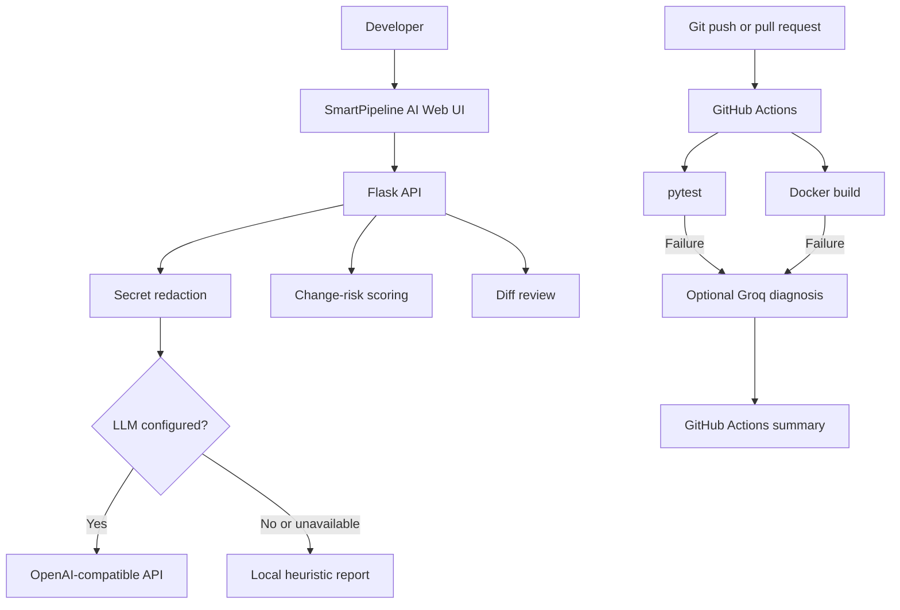
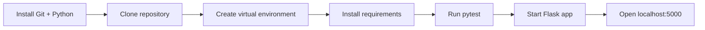

# SmartPipeline AI

AI-assisted DevOps toolkit for CI/CD log diagnosis, change-risk scoring, and pull-request diff review. Built with Flask, Python, Docker, GitHub Actions, and an optional OpenAI-compatible LLM provider.

> Learning/portfolio project. AI reports are advisory, not proof of root cause or a security approval.

## What it does

- **CI log diagnosis:** highlights likely errors and evidence; falls back to local heuristic analysis if an LLM is unavailable.
- **Change-risk scoring:** assigns a transparent, path-based advisory score.
- **Pull-request review:** provides an optional AI-assisted review of a diff.
- **Secret redaction:** removes several common credential patterns before log analysis. Redaction is best-effort; never submit real secrets.
- **Automated checks:** runs pytest and a Docker build in GitHub Actions. On CI failure, the workflow can request a Groq diagnosis and add it to the Actions summary.

## Architecture



## Install locally

### 1. Install prerequisites

You need Git and Python 3.10+ (the CI workflow uses Python 3.12). Docker is optional unless you want to run the container.

Check your versions:

```bash
git --version
python3 --version
```

### 2. Clone the repository

```bash
git clone https://github.com/Abhishekk-20/smartpipeline-ai-web.git
cd smartpipeline-ai-web
```

### 3. Create and activate a virtual environment

**Linux / macOS:**

```bash
python3 -m venv .venv
source .venv/bin/activate
```

**Windows PowerShell:**

```powershell
py -m venv .venv
.venv\\Scripts\\Activate.ps1
```

### 4. Install dependencies

```bash
python -m pip install --upgrade pip
pip install -r requirements-dev.txt
```

### 5. Run the tests

```bash
python -m pytest -q
```

Expected result on the current test suite: **4 passed**.

### 6. Start the web app

```bash
python app.py
```

Open **http://127.0.0.1:5000** in your browser. Use the sample data in the UI to try the tools.

### Setup flow at a glance



## Optional LLM setup

The local heuristic analyzer and risk scoring work without an LLM provider. To use an OpenAI-compatible local endpoint, for example Ollama, start Ollama and pull a model:

```bash
ollama pull llama3.2:3b
```

Then, in the same terminal where you start the app:

```bash
export LLM_BASE_URL=http://localhost:11434/v1
export LLM_MODEL=llama3.2:3b
export LLM_API_KEY=ollama
python app.py
```

For Windows PowerShell, use:

```powershell
$env:LLM_BASE_URL = "http://localhost:11434/v1"
$env:LLM_MODEL = "llama3.2:3b"
$env:LLM_API_KEY = "ollama"
python app.py
```

These are example local Ollama settings. Other OpenAI-compatible providers may require a different base URL, model name, and API key. Keep credentials in environment variables or a secret manager; never commit them.

## Run with Docker

Build the image:

```bash
docker build -t smartpipeline-ai .
```

Start the container:

```bash
docker run --rm -p 5000:5000 smartpipeline-ai
```

Open **http://127.0.0.1:5000**. Stop the container with `Ctrl+C` in the terminal.

If using an LLM running on the host, remember that `localhost` inside a container refers to the container itself. Configure a reachable host address appropriate for your environment.

## API endpoints

| Method | Endpoint | Purpose |
|---|---|---|
| GET | `/health` | Health check |
| POST | `/api/analyze-log` | Analyze a log; JSON body: `{"log":"..."}` |
| POST | `/api/risk-score` | Score changed paths; JSON body: `{"paths":["k8s/deployment.yaml"]}` |
| POST | `/api/review` | Review a diff; JSON body: `{"diff":"..."}` |

Quick health check:

```bash
curl http://127.0.0.1:5000/health
```

## GitHub Actions CI

The workflow in `.github/workflows/ci.yml` runs tests and builds a Docker image. If tests or the Docker build fail, it can send a redacted log excerpt to Groq and write the diagnosis to the Actions step summary. The workflow preserves the failed status even if diagnosis succeeds.

To enable Groq diagnosis, configure a repository Actions secret named `GROQ_API_KEY` in **Settings → Secrets and variables → Actions**. Never place the key directly in the workflow or commit it to the repository.

## Safety and limitations

- AI output is advisory; verify claims against the original logs.
- Secret redaction is best-effort, not a guarantee. Do not paste real credentials, customer data, or confidential logs.
- Path-based risk scoring is a heuristic, not a security scanner or deployment approval.
- Before exposing the app to a network, add authentication, TLS, rate limiting, stronger secret scanning, and an appropriate data-retention policy.
- Keep deterministic tests, security scanners, and human approval for production deployments.

## Project stack

Python · Flask · pytest · Docker · GitHub Actions · Groq API (optional) · OpenAI-compatible LLM API (optional)
